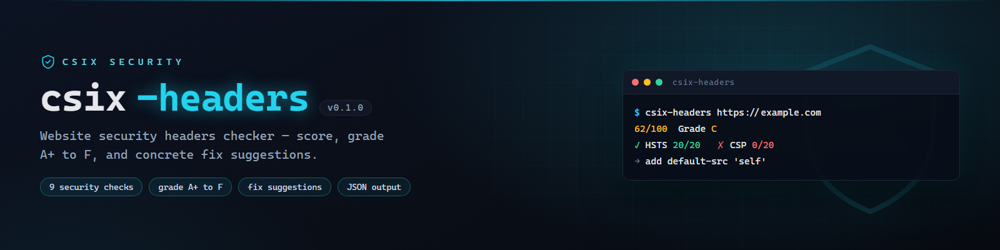

# csix-headers



**Pemeriksa security headers website — grade A+ s/d F, murni Go.**

> English documentation: [README.md](README.md)

## Apa ini?

`csix-headers` menilai 9 pemeriksaan header keamanan sebuah situs (HSTS,
CSP, X-Frame-Options, dll) lalu memberi **skor 0–100 + grade A+…F** beserta
saran perbaikan konkret. Mirip securityheaders.com, tapi CLI & gratis.

## Instalasi & Pakai

Unduh binary siap pakai di [halaman Releases](https://github.com/siedysoes/csix-headers/releases/latest)
(Windows / Linux / macOS, amd64 + arm64), atau:

```sh
go install github.com/siedysoes/csix-headers@latest

csix-headers https://example.com
csix-headers --json https://siedysoes.github.io/csix-phish/
```

**Exit code:** `0` lolos · `1` skor < 65 (bisa diubah `--min-score`) · `2` error

## Checklist Sebelum Push ke GitHub

1. Ganti `siedysoes` di `go.mod`, `main.go`, dan README dengan username
   GitHub Anda (jika berbeda).
2. Buat repo baru `csix-headers`, push folder ini.
3. Aktifkan **Actions** di repo.

## Lisensi

MIT. Untuk tujuan defensif.
