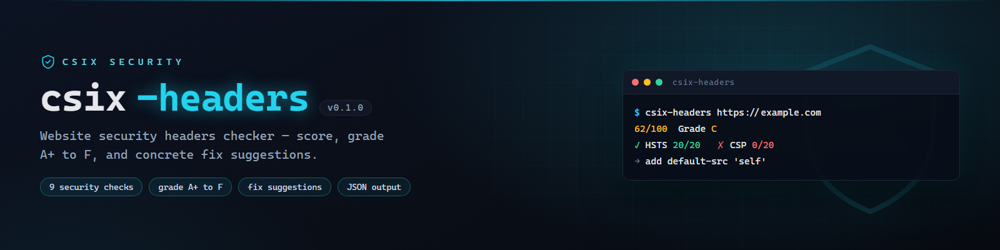

# csix-headers



**Website security headers checker — grade A+ to F, pure Go, single binary.**

[](https://github.com/siedysoes/csix-headers/actions/workflows/ci.yml)
[](https://github.com/siedysoes/csix-headers/releases)
[](LICENSE)

`csix-headers` fetches a URL and scores 9 security header checks — giving a
**0–100 score + letter grade (A+ … F)** along with concrete fixes for every
missing or weak header.

Similar to [securityheaders.com](https://securityheaders.com), but: CLI,
free with no limits, JSON output, and CI-friendly.

## Features

- 🎓 **Grade A+ to F** + transparent numeric score
- ✅ 9 checks: HSTS, CSP, X-Content-Type-Options,
  X-Frame-Options/frame-ancestors, Referrer-Policy, Permissions-Policy,
  COOP, COEP, CORP
- 💡 **Concrete fix suggestions** for every weak header
- 🔔 Info notes: server version leaks (`Server`, `X-Powered-By`),
  deprecated headers (`X-XSS-Protection`)
- 📦 `--json` for tooling integration
- ⚡ Single binary, zero dependencies

## Installation

### Prebuilt binaries

Download the latest binary for your platform from the
[Releases page](https://github.com/siedysoes/csix-headers/releases/latest)
(Windows / Linux / macOS, amd64 + arm64), then verify it:

```sh
sha256sum -c checksums.txt
```

### Go

```sh
go install github.com/siedysoes/csix-headers@latest
```

## Usage

```sh
csix-headers https://example.com
csix-headers --json https://example.com
```

Example output:

```
csix-headers v0.1.0 — security headers checker

  Target   https://example.com
  Score    9/100   Grade F
  ──────────────────────────────────────────────────────────────
  ✗ Strict-Transport-Security (HSTS)               0/20
      → Strict-Transport-Security: max-age=31536000; includeSubDomains
  ✗ Content-Security-Policy (CSP)                  0/20
      → Content-Security-Policy: default-src 'self'; object-src 'none'; ...
  ~ Referrer-Policy                                5/10  (follows browser default)
  ...
```

## Options

| Flag | Description |
|------|-------------|
| `--json` | JSON output |
| `--min-score <n>` | Minimum passing score (default 65 → exits 1 below this) |
| `--timeout <dur>` | Request timeout (default `10s`) |
| `--insecure` | Skip TLS certificate verification |
| `--no-color` | Disable colored output (also honors `NO_COLOR`) |
| `--version` | Print version |

**Exit codes:** `0` pass · `1` score below threshold · `2` error

## Scoring

| Header | Weight |
|--------|-------|
| Strict-Transport-Security | 20 |
| Content-Security-Policy | 20 |
| X-Content-Type-Options | 15 |
| X-Frame-Options / frame-ancestors | 10 |
| Referrer-Policy | 10 |
| Permissions-Policy | 10 |
| COOP · COEP · CORP | 5 + 5 + 5 |

**Grade** = score as a percentage of the maximum:
`A+` 100 · `A` 90 · `A-` 80 · `B` 65 · `C` 50 · `D` 35 · `F` <35

`http://` targets are scored without HSTS (maximum 80) because HSTS only
applies over HTTPS.

## Languages

- English (this file)
- [Bahasa Indonesia](README.id.md)

## License

MIT — see [LICENSE](LICENSE). For defensive purposes.
